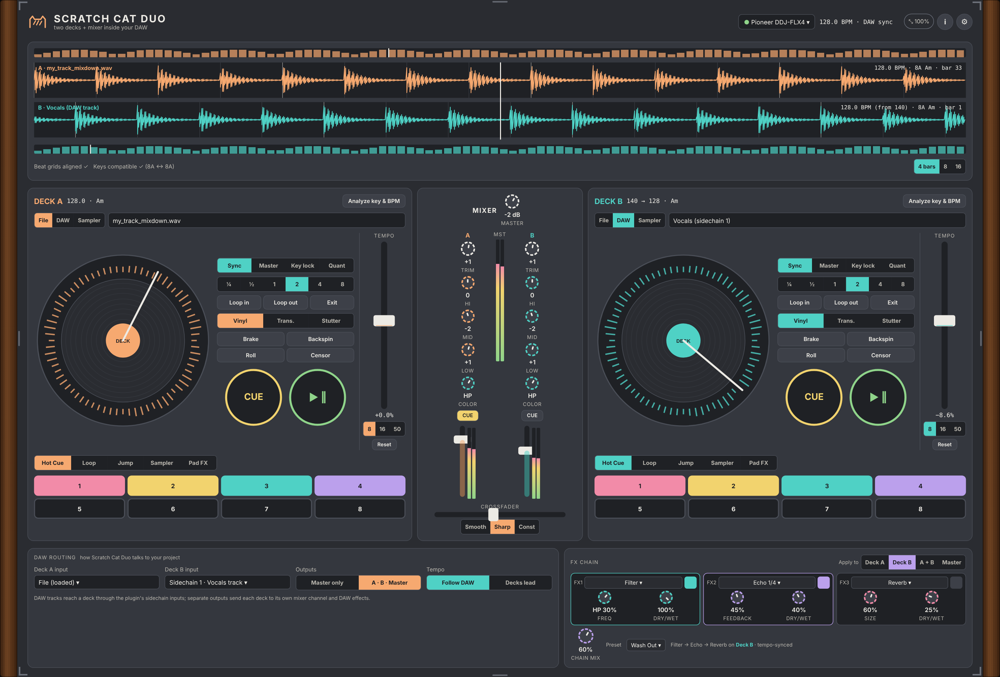

# Scratch Cat Duo 🐈

Two DJ decks and a mixer in one plugin (VST3 and standalone). Free and open source, Linux first.

 Screenshot of the interactive mockup in docs/mockups.

**Manual:** [PDF, opens in the browser](https://github.com/SpeakingColors/scratchcatduo-vst/blob/main/docs/scratchcatduo-vst-manual.pdf)

## What works now (v0.2)
- The window is the approved mockup, built for real: waveform section with overviews, two decks with pad tabs (hot cues you can name, colour and edit, loops, jumps, sampler, pad FX), mixer with kill buttons and meters, DAW routing, three slot FX chain, track browser with favourite folders, presets (factory and your own), Guide, Settings, About.
- Two decks: load wav, aiff, flac, ogg or mp3; BPM, beat grid and key (Camelot) analysis; scratch on the platter, cue, 8 hot cues, loops, brake, backspin, vinyl mode, roll, censor, stutter, transform, key lock (WSOLA aligned grains), tempo fader (8, 16, 50 %), sync to the DAW tempo or the other deck.
- DAW input mode: send a DAW track to a deck and scratch the last minute of it.
- Mixer: trim, 3 band EQ with kill, colour filter, channel faders, crossfader (smooth, sharp, constant power), cue (headphone) output, master.
- FX chain of three (filter, echo, reverb, flanger, crush) on deck A, deck B, A+B or master.
- Separate outputs for each deck, MIDI learn, stacked waveforms on one time axis.
- Not tuned by ear yet, and the editor has not been tried in a running DAW. The DDJ-FLX4 controller list from the mockup is not built (use MIDI learn). Controller maps for specific devices need verified MIDI charts and are not included.

  

☕ Free and open source, made by one person. If it helps your music, a coffee on [Ko-fi](https://ko-fi.com/studio87) keeps it coming. 💜

## Docs
- [Interactive mockup](docs/README.md)
- [Roadmap](ROADMAP.md)
- Build: `cmake -S . -B build` (JUCE and cat-ui are fetched). Engine tests without JUCE: `sh tests/run.sh`.

## License
AGPL-3.0-or-later, see [LICENSE](LICENSE).

Not affiliated with or endorsed by any hardware maker named here. All trademarks belong to their owners.
